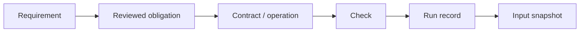

# Type-Driven Design as Evidence-Linked Engineering

## A practical thesis for Dotdog

Prepared for Specdog. Research cutoff: 31 October 2026. Applied technical thesis, not a claim of a released feature or a peer-reviewed result.

## Abstract

Type-driven design uses representations and operation signatures to guide implementation. Specifications express intended behavior, while software graphs connect engineering artifacts. These practices can cooperate, but none substitutes for the others. This thesis argues that Dotdog's defensible opportunity is not another compiler, schema language, or code graph. It is a small evidence-linking layer that helps a developer identify which stated rules have relevant, current checks and which remain unsupported.

The investigation combines primary-source literature, inspection of Dotdog, a selected-symbol extraction prototype, runtime boundary experiments, and a graph-evidence bookkeeping experiment. The earlier prototype passed 47 automated checks, including 2,000 malformed-input trials, 500 generated valid manifests, and targeted extraction from two public codebases on two compiler versions. All 16 selected symbol/compiler combinations resolved, but ten contexts remained explicitly partial. The experiments reproduced production validator defects and an optional-property compatibility gap in the parser prototype. Fourteen additional graph-evidence cases test missing, stale, unreviewed, ambiguous, and incorrectly classified evidence.

The proposed integration keeps the chosen contract source authoritative, uses existing compilers and validators, and makes graph links inspectable rather than treating them as proof. Its strongest immediate use is a bounded Dotdog dogfood pilot around workspace input and command-selection rules. Improved review speed, better agent output, and standalone-product demand remain hypotheses requiring separate evaluation. The conclusion is therefore conditional: integrate a narrow, optional evidence workflow before considering a new tool or broad correctness claims.

## 1. The problem and the thesis

### 1.1 What a Dotdog user actually needs

A developer maintaining several repositories rarely needs another list of interfaces. The difficult questions are operational: which consumer is affected by this change; why does this field exist; where is this input checked; which test demonstrates that a forbidden operation is rejected; and whether last week's result still applies to today's source.

Dotdog already positions itself around structured intent, repository mapping, and agent-readable graphs. Its inspected source includes workspace configuration types, manifest validation, repository selection, and graph-query infrastructure. The current data-design audit examines modeling gaps, not application type safety. The selected checkout must therefore be distinguished from the proposed addition: type-context extraction and evidence-aware rule links are research prototypes, not released Dotdog capabilities. [20,21]

The practical deficiency is not that compilers lack graphs. It is that intended rules, language-level representations, runtime boundaries, and verification results are usually maintained in different places. A green compiler result may not address the rule under review. A spec-to-file link may locate relevant code without establishing that the code enforces anything. A previously passing test may be stale.

### 1.2 Central proposition

**Dotdog should help users navigate from a reviewed rule to its implementation obligations and current verification evidence, while preserving the distinctions between intent, representation, behavior, and evidence freshness.**

This is an application and integration thesis, not a claim that type-driven design or traceability is new. The value proposition is testable: reduce the work needed to locate relevant enforcement and expose gaps that a plain compiler run or file graph does not explain. Whether that benefit exceeds maintenance cost has not yet been demonstrated in a user study.

### 1.3 Research questions

1. Where can type-driven design improve an actual Dotdog workflow rather than add terminology?
2. Which obligations can types express, and which require runtime checks or other reasoning?
3. What must graph evidence record before a user can safely interpret a coverage claim?
4. Which existing tools should be reused, and what additional dependency burden is justified?
5. What evidence would justify a standalone tool rather than a module inside Dotdog?

The thesis answers the first four with an architecture, worked use cases, and bounded experiments. It provides decision criteria rather than an empirical answer to the fifth.

## 2. Research method and evidence boundaries

### 2.1 Method

This is an exploratory design investigation. Sources were selected for direct relevance to types-first implementation, compiler-backed context, traceability, contract generation, and compatibility. Preference was given to original papers and official documentation. This is not an exhaustive systematic review, and first-party product documentation establishes documented capability, not comparative effectiveness.

The empirical work has three parts. Phase A tests selected-symbol extraction, type contracts, boundary parsing, and narrow compiler-version behavior. Phase B evaluates evidence-state logic using explicitly synthetic graph fixtures. A proposed Phase C would measure real developer and coding-agent outcomes; it has not been conducted.

### 2.2 Inspected artifacts

The Dotdog corpus is pinned to commit `773dc265ecc30f1ec3cb417d1eb051719ea78ba9`. The independent Type-Fest corpus is pinned to `c3e825ffc1e687dd13a0003b771802d95964aaf9`. Phase A results and retained experiment notes are versioned in the research harness. The baseline harness was committed as `38e2b7e`; subsequent graph-evidence work is separately identified by source hashes in the thesis test record. [20-22]

No production Dotdog source was changed by these experiments. Targeted research configurations were used rather than either repository's complete build. Reference builds require their own treatment rather than an equivalent-looking single-program compilation. [17] The corpus was chosen for engineering relevance and type complexity, not sampled to represent all software projects. Selection therefore limits generalization.

### 2.3 Claim classes

This thesis distinguishes four kinds of statement. An **observation** reports inspected source or executed behavior. A **documented capability** reports what a primary source specifies. A **proposal** describes a future Dotdog behavior. A **hypothesis** predicts a user or performance benefit that still requires measurement. These categories must not be collapsed into a single product promise.

Passing tests establish only their asserted conditions. In particular, tests that reproduce a known crash or compiler incompatibility can pass while the underlying defect remains unfixed. That convention is explicit in the retained results. [21]

## 3. Foundations and related work

### 3.1 Type-driven design is a construction method

In a types-first workflow, the programmer chooses representations and signatures before completing implementations, then revises both as understanding improves. Idris demonstrates this construction-oriented use of types through interactive editing, case splitting, and inspection of unfinished definitions. This is stronger than adding annotations after writing an algorithm. [1]

Ordinary domain modeling can use the same direction without adopting dependent types. Instead of independent flags such as `paid`, `shipped`, and `cancelled`, a developer can model alternatives whose required data varies by state. Wlaschin's worked examples illustrate how representation choices can exclude combinations that a looser record permits. The relevant lesson is to encode the rule where feasible, not to maximize type-level sophistication. [2]

### 3.2 Parsing preserves established information

A runtime predicate can confirm an input property and then discard that knowledge. A parser can instead return a value whose type retains the established structure. King's argument for parsing into stronger values motivates a boundary between untrusted input and domain operations. It does not remove the runtime check; it changes what the successful check returns. [3]

This distinction matters for Dotdog's workspace manifests. A function returning `{ valid: true }` does not itself provide a correctly shaped configuration value to its caller. A discriminated parse result can make successful data available only in the success branch. That design is useful even without a graph. The graph becomes useful when a maintainer needs to locate the rule, parser, consumers, and relevant checks together.

### 3.3 Type guarantees depend on language and configuration

TypeScript uses structural compatibility and permits some intentionally unsound behavior. Different string-alias names do not establish nominal identity. Assertions and `any` can bypass ordinary checking. Compiler settings also change which programs are accepted. Consequently, a Dotdog integration cannot describe a TypeScript check as an unconditional guarantee. [4]

Rust typestate can associate operations with particular state types and consume a value during a transition. This can prevent reuse of that value, unlike a typical TypeScript union. It still does not prove that two values do not represent the same external order or that a remote side effect occurs only once. Language-specific adapters must preserve such differences. [5]

### 3.4 Traceability is established engineering work

The traceability literature treats links as relationships among engineering artifacts that must be created, maintained, and used. The 2014 research roadmap provides a basis for understanding trace creation and maintenance as a lifecycle problem, not a diagram-generation task. [6]

Research on live traceability deployment further emphasizes the practical difficulty of maintaining useful links and the role of domain knowledge and available data. This cautions against assuming that generating more edges automatically produces more useful engineering knowledge. For Dotdog, reviewed links and visible uncertainty are therefore preferable to presenting all inferred relationships as equally authoritative. [7]

### 3.5 Existing navigation and contract tools

SCIP already provides a language-independent indexing protocol for source navigation, including definitions and references. LSP standardizes editor-facing language interactions. These are relevant integration surfaces, not evidence that Dotdog needs to replace language servers or build a universal semantic indexer. [8,9]

TypeSpec supports designing API contracts and emitting several representations. Buf distinguishes source-code and wire-compatibility categories for Protobuf changes. These systems address important parts of contract authoring and evolution that should not be rebuilt casually inside Dotdog. [10,11]

Schema export is not a universal bridge between type systems. Zod documents constructs that cannot be faithfully represented as JSON Schema. JSON Schema also has its own required-property and additional-property semantics. An exported shape is not necessarily a lossless representation of an application type, validator transform, or lifecycle policy. [12,19]

### 3.6 Type context for coding agents

The ChatLSP work investigates supplying type and binding context to language models. Its TypeScript implementation used a proof-of-concept approach, including manually simulated relevant-header retrieval, and its threats-to-validity discussion limits broad conclusions. It supports investigating semantic context, not claiming that this Dotdog prototype improves arbitrary agent tasks. [13]

Type-constrained generation is a different mechanism. The PLDI 2025 work constrains generation through a specialized incremental engine over a supported language subset. Ordinary post-generation compiler feedback should not be described as equivalent token-level enforcement. [14]

TypePilot provides another distinct approach: type-focused revision of generated Scala code. Its small examples and verification difficulties make it useful motivation for structured workflows, but not proof of whole-project reliability. The thesis accordingly avoids transferring published benchmark improvements to Dotdog. [15]

## 4. An evidence-linked model for Dotdog

### 4.1 Separate the authorities

Four responsibilities must remain distinct. A specification records intended behavior and rationale. A canonical contract source defines the chosen machine-readable representation. An implementation performs operations. A check produces evidence under stated conditions.

The canonical contract source is a project decision. In a code-first project it may be application types and parsers. In a schema-first project it may be TypeSpec, Protobuf, or another maintained contract. Generated code must not silently become a second editable authority. Dotdog's graph should point to the configured source rather than create a third copy of the contract in `.dog` files.

Specs and graphs are optional for type-driven design itself. Their justification inside Dotdog is traceability and coordinated change, not making a compiler function.

### 4.2 Graph structure

Let the evidence graph contain requirements, obligations, contract symbols, operations, boundaries, checks, runs, and input snapshots. Edges record relationships such as a requirement explaining an obligation, an operation using a type, a check exercising an obligation, and a run observing a check under a snapshot.

The essential path is:

This graph is an index of engineering claims and observations. It is not a theorem prover. An `implements` edge means that someone or some process associated artifacts; it does not establish that the implementation satisfies the requirement.

Identity must include repository and symbol context. A type named `State` in one package is not interchangeable with another package's `State`. Recursive types and legal state cycles also mean traversal cannot assume that all underlying relationships are acyclic merely because an artifact uses the `.dag` extension.

### 4.3 Obligations prevent false completeness

A rule should be decomposed into obligations that are meaningful for that rule. A manifest-input rule might require compile-time narrowing, runtime shape rejection, and semantic cross-reference checks. A payment rule may require runtime authorization and idempotency even when a state type restricts which operation can be called.

The obligation list is reviewed engineering input, not automatically inferred truth. A type checker result cannot be relabeled as runtime evidence. A runtime example test cannot establish that every forbidden type-level call is rejected. A generic graph path cannot substitute for either.

This approach intentionally avoids a single completeness percentage. A rule can have one current compile check, a stale runtime result, and an unresolved semantic obligation. Collapsing those states into one number would hide the distinction most relevant to the reviewer.

### 4.4 Freshness is necessary, not sufficient

For a particular check, a current-evidence label requires a reviewed association, the expected check kind, a passing result, and matching tracked inputs. The record must include the relevant rule revision, contract and implementation hashes, check-definition hash, compiler identity, and configuration identity. Ambiguous histories must be resolved explicitly rather than selecting an old pass because it appears first.

This is an operational evidence predicate, not semantic entailment. Correct hashes cannot rescue an irrelevant test or a wrong rule. A complete list of tracked inputs is itself an assumption. When an adapter reports partial dependency context, the system must not present the result as a complete-evidence claim.

Whole-file hashes are conservative but can invalidate evidence after irrelevant edits. Signature-only hashes are cheaper but may miss behavior changes. The first pilot should prefer conservative invalidation, expose its cause, and measure the review burden before attempting more aggressive semantic caching.

### 4.5 Proposed user-visible answers

The useful output is not simply a picture. A future Dotdog view could answer: this rule has a current compile check; its runtime check predates the parser change; these consumers reference the changed contract; and this inferred link has not been reviewed.

The existing research evaluator only tests a small part of that behavior using explicit fixtures. It does not automatically create reviewed links from natural language, discover all dependencies, or ingest arbitrary CI logs. Those are separate integration tasks.

## 5. Real-life uses and adoption order

### 5.1 Workspace manifest parsing: the first dogfood case

The strongest immediate case is Dotdog's own manifest boundary. The inspected validator accepts `unknown` but throws on malformed nested values such as a null repository entry. It also accepts an incomplete group lacking its repository list. These behaviors were executed against the pinned checkout, not inferred from a hypothetical customer story. [20,21]

The type-driven intervention is to parse raw data into a discriminated result before domain operations use it. A developer first defines what a valid workspace contains, then checks that success exposes that data while failure exposes diagnostics. Runtime checks retain the cross-reference rules already present in the validator.

The graph's added value would be coordination: link the manifest rule to the schema, the parser, `WorkspaceConfig`, its consumers, and the exact compile/runtime checks. When an optional field changes, Dotdog could identify the relevant obligations and invalidate affected evidence. The immediate benefit is a clearer failure and review path, not a new type system.

The current Zod-based prototype is not ready to replace the production validator. [18] Its optional-property inference conflicts with the existing interfaces under exact optional-property checking, and its default object parsing strips unknown fields. Both policies require explicit review before adoption.

### 5.2 Explicit multi-repository command selection

The inspected selection code uses a discriminated `WorkspaceSelection` and rejects conflicting CLI selectors at runtime. A related guard rejects implicit selection when multiple repositories would be affected. This is already a practical separation between raw options, domain selection, and operational policy. [20]

Type-driven design can keep internal callers from constructing incomplete selection variants. Runtime parsing remains necessary for command-line input, and the multi-repository guard remains necessary for the chosen policy. The graph could connect the policy to the parser, selection type, guard, command consumers, and tests.

The user benefit would be targeted maintenance: a new selector should lead the reviewer to every handling branch and policy check, not merely every text occurrence of the word `repo`. This benefit is proposed; the experiments did not measure review time or complete command-level integration.

### 5.3 Lifecycle changes in an application

Consider a worked scenario in which an application adds a refunded state to an order lifecycle. The scenario is illustrative, not an observed Dotdog customer deployment. A type-first workflow changes the state representation and operation signatures, lets exhaustive handlers reveal omissions, and then adds runtime checks for amounts, authorization, and external side effects.

A graph can connect the intended change to the state type, transition functions, API responses, rendering branches, and tests. Its contribution is explaining the affected surface and the remaining obligations. It cannot turn a type label into evidence that a payment was captured or a shipment occurred.

The earlier contract experiments tested the smaller mechanism: adding a variant produces a diagnostic when an explicit exhaustive handler is left unchanged; weakening the handler removes that rejection. They did not test a deployed payment or fulfillment system.

### 5.4 Contract evolution across frontend and backend

In another worked scenario, an API renames a field or changes its optionality. Type-driven work should start from the project's chosen contract authority, then regenerate or update consumers and check actual serialization behavior. TypeSpec or Protobuf tooling may already own this part of the workflow. [10,11]

Dotdog should add an impact and evidence layer: identify producers and consumers, the compatibility policy each check applies, and which contract version each result covers. Source compatibility, JSON compatibility, and binary wire compatibility are different questions. A graph may connect them, but must not collapse them into one generic breaking-change label.

Cross-language nominal identity is particularly limited. A TypeScript brand is not automatically transmitted in JSON or recreated by another language's generated model. Validation and version policy must remain explicit at the boundary.

### 5.5 Focused context for a coding agent

For a selected operation, the prototype can retrieve its signature and relevant named type declarations. The real-code experiment resolved selected symbols through two compiler versions without exporting function bodies as the default context. It also exposed partial closure for complex library types. [21,22]

A future Dotdog task workflow could combine a spec rule, selected type context, reviewed links, and check commands. The agent would receive bounded context and explicit gaps rather than the entire repository graph. However, the current adapter requires a selected file and export; it does not independently choose the right operation from a user task.

The expected benefit is less rediscovery and more relevant constraints. That remains a hypothesis until tested against ordinary repository context and existing spec/graph context under the same coding tasks, budgets, and behavioral checks.

### 5.6 Priority

| Candidate | Why investigate it | Evidence today | Main unresolved question |
| --- | --- | --- | --- |
| Manifest parsing and its rule links | Concrete local defects and a small boundary | Runtime and compile experiments | Optional-field and unknown-field policy |
| Explicit workspace selection | Existing domain type and operational guard | Source inspection and type extraction | Command-level trace completeness |
| Contract-change review | Clear multi-repo coordination problem | Worked scenario and existing external tools | Consumer coverage and review cost |
| Agent task context | Plausible fit with graph-query workflows | Selected-symbol feasibility | Measured task improvement |

This ordering is an engineering judgment based on scope and available evidence, not a market-demand ranking.

## 6. Architecture and dependency policy

### 6.1 A small integration surface

The proposed module has three responsibilities: read contract and symbol information from supported tools; associate reviewed obligations with source and checks; and report evidence state with provenance. It should reuse existing Dotdog graph components where their semantics fit. A new graph database, language, or hosted service is not required for the first pilot.

An extraction adapter should identify its compiler and configuration, resolve imported symbols, state what it omitted, and invalidate results when relevant inputs change. A runner adapter should distinguish intended negative diagnostics from environmental failure. A graph query should preserve those distinctions rather than manufacture an overall green result.

### 6.2 What not to rebuild

Do not rebuild compiler type inference, schema validation, API generation, or Protobuf compatibility checking. Do not fork existing contract definitions into a parallel Dotdog-only type DSL. Do not equate an automatically inferred association with a reviewed claim of enforcement.

SCIP and language-server interfaces are candidates for broader indexing and navigation integration. TypeSpec and Buf are candidates for contract-aware metadata. These are architectural options supported by documented capabilities, not integrations implemented by this thesis. [8-11]

### 6.3 Additional dependencies

No dependency was added to production Dotdog. The research harness has five direct development dependencies: three aliased TypeScript versions, Zod, and fast-check. The new graph-evidence evaluator uses only ordinary JavaScript. PDF-rendering packages are document-production tools, not Dotdog runtime requirements. [21]

A production pilot should use the project's supported compiler and existing parser where possible. Compiler matrices and property-testing packages belong to development checks. The research harness's tested Node version must not silently become a new requirement for every Dotdog user.

TypeScript 7.1 beta has a replacement API with different entry points and explicit object lifetimes. The separate snapshot smoke test confirms a narrow diagnostic/repair path, not compatibility of the older extractor. A production adapter therefore needs an explicit version-support policy rather than a universal `typescript` import assumption. [16]

## 7. Evaluation and results

### 7.1 Phase A: extraction, contracts, and boundaries

The retained local suite passed 47 checks with zero failures or skips. A clean lockfile-based installation also passed 47. The prior Linux CI runs passed. The environment and package versions are recorded with the results. [21]

The generated runtime trials used fixed seeds: 1,000 arbitrary JSON values, 1,000 mutations of nested manifest fields, and 500 generated valid manifests. The valid-input control matters: a parser that rejects everything would look robust on malformed inputs while being useless. The prototype returned structured outcomes for the malformed trials and preserved the generated valid configurations.

Four deliberate contract weakenings were exercised on both older compiler versions: removing distinct ID brands, widening an accepted state, making required state data optional, and weakening an exhaustive handler. Original negative cases produced their intended diagnostics; the weakened contracts stopped rejecting those cases. This is a bounded mutation-style experiment, not a full mutation score from Stryker. [23]

### 7.2 Phase A: real-code context

Four selected targets in each corpus were evaluated with TypeScript 5.9.3 and 6.0.3. All 16 target/compiler combinations resolved. Six returned checked context and ten returned partial context. The per-target classifications agreed between these two compiler versions.

| Target | Context bytes | Classification |
| --- | ---: | --- |
| Dotdog selectionFromOptions | 360 | checked |
| Dotdog WorkspaceConfig | 907 | checked |
| Dotdog RepositoryWorldModel | 1,783 | partial |
| Dotdog auditDesign | 646 | checked |
| Type-Fest Simplify | 664 | partial |
| Type-Fest Merge | 5,724 | partial |
| Type-Fest Jsonify | 7,523 | partial |
| Type-Fest Tagged | 348 | partial |

The extractor respected its 16 KB output budget. Complex utilities reached declaration limits or referenced external definitions. Byte sizes are not model-token measurements, and smaller context is not automatically better context. These results do not establish token savings, successful task completion, or complete semantic closure.

Initial failures were retained. A generic-parameter traversal mistake was corrected. An inappropriate module-resolution configuration and stricter optional-property policy produced diagnostics in the first Dotdog corpus run; the final targeted configuration records the chosen policy explicitly. No production source was modified to manufacture a pass.

### 7.3 Phase B: graph-evidence behavior

Fourteen additional tests evaluate the research evidence-state function. Their data are synthetic and explicitly reviewed fixtures, not automatically recovered production trace links. The tests cover a valid evidence checklist and thirteen situations that must not produce the same result.

Those situations include a missing runtime check, an unreviewed link, changed parser content, changed compiler or configuration, a missing symbol, a skipped or failed check, a changed requirement, a mismatched check kind, ambiguous run history, partial context, and unknown completeness. The purpose is to test bookkeeping distinctions that a future Dotdog graph must preserve.

All fourteen targeted cases passed locally. Both combined-suite runs passed 61 checks with zero failures or skips, including the clean lockfile-based environment. The associated thesis test record retains counts, timings, and source hashes. Passing these fixtures establishes neither the relevance of real links nor the completeness of actual dependency capture.

### 7.4 What is and is not supported

The experiments support selected-symbol extraction on the tested configurations, discriminated boundary-result design under the compatible optional-field policy, and explicit evidence-state handling in the fixture model. They also demonstrate useful failure modes rather than merely collecting green checks.

They do not establish a production graph integration, universal compiler compatibility, complete repository verification, a security guarantee, reduced developer effort, improved agent output, or customer demand. The primary product hypothesis remains open.

## 8. Limitations, counterarguments, and alternatives

### 8.1 Trace maintenance may cost more than it saves

The strongest objection is that users can already run their compiler and tests. If Dotdog requires substantial manual linking and produces only another checklist, the addition may make work slower. The pilot must therefore measure link-maintenance time alongside retrieval or review benefits. Traceability deployment research makes this a substantive concern rather than an incidental UX issue. [7]

### 8.2 A typed model can faithfully encode the wrong rule

Types constrain programs according to the chosen representation. They cannot establish that the representation matches the user's intent. Similarly, a graph may accurately connect a requirement to an irrelevant test. Review remains necessary at the intent-to-obligation boundary, and experimental evaluation must include incorrect but plausible links.

### 8.3 Partial information is normal

Recursive utility types, external dependencies, generated contracts, dynamic configuration, and cross-repository deployments complicate evidence capture. The real-code experiment's ten partial contexts should therefore shape the interface, not be hidden as exceptional errors. A partial report can still be useful if its scope is clear; it is unsuitable as an unrestricted completeness claim.

### 8.4 Temporal and operational rules exceed ordinary shape types

Authorization, idempotency, actual external side effects, and many numeric relationships remain runtime concerns in ordinary application type systems. More expressive verification systems can address some such obligations, but adopting them would be a separate product and engineering decision. This thesis does not propose that Dotdog become a general verification language.

### 8.5 A graph may be unnecessary

A small repository with a clear contract module and a handful of tests may gain little from graph bookkeeping. A plain reviewed mapping file and existing check commands may be sufficient. The graph is justified when relationships are reused for change impact, cross-repository coordination, onboarding, or bounded agent context. Visualization is optional; useful queries are the primary benefit.

### 8.6 Stronger incumbent tooling may be the right answer

If the user's main problem is API-contract generation, TypeSpec may be the more direct investment. If it is Protobuf compatibility, use the existing Buf policy. If it is source navigation, existing language tools or SCIP indexes may suffice. Dotdog should add context and evidence relationships around such tools only when that combination reduces real work. [8-11]

## 9. Validation plan and decision gates

### 9.1 First implementation experiment

Start with one reviewed rule family around workspace input, not every entity in every graph. Resolve the optional-field and unknown-field policies. Associate the existing and prototype checks with explicit obligations. Run both successful and malformed input cases, change a contract and a parser body, and verify that the graph reports the right evidence as stale or incomplete.

A second bounded case can address workspace selection and its explicit multi-repository policy. Its purpose is to test a different obligation mix, not to inflate a count of mapped symbols.

### 9.2 Developer evaluation

Use concrete maintenance tasks: add a manifest field, add a selection variant, and review a producer/consumer contract change. Compare existing compiler/test tools, ordinary Dotdog graph context, and the proposed evidence-linked view. Counterbalance task order and preserve the same acceptance criteria. Measure time to find the relevant checks, missed obligations, incorrect links accepted, review decisions, and time spent repairing the links themselves.

These measures should be interpreted together. A faster answer with a missed runtime obligation is not an improvement. A larger graph is not success. No numeric benefit target is justified by the present data.

### 9.3 Coding-agent evaluation

Compare the same coding tasks under ordinary repository context, spec/graph context, and added semantic type/evidence context. Keep model, budget, instructions, and behavioral checks constant. Repeat runs where generation varies and retain unsuccessful outputs. Measure functional acceptance, relevant diagnostic handling, repair attempts, actual prompt tokens, latency, and harmful changes outside task scope.

This is a distinct experiment from the current compiler probes. It is required before advertising improved coding-agent performance or token efficiency.

### 9.4 Split into a standalone tool only on evidence

A standalone tool becomes plausible if users repeatedly obtain value from contract/evidence inspection without adopting Dotdog specs or graphs, and if maintaining an independent installation does not erase that benefit. Until then, a separable module inside Dotdog limits coordination and dependency cost without pretending to settle the product question.

## 10. Conclusion

Type-driven design can work with specs and graphs, but not because a graph grants types new enforcement power. Types shape the implementation; parsers and tests check additional obligations; specs express intent; graphs connect those artifacts and their changing evidence.

For Dotdog, the immediate opportunity is concrete: make it easier to identify the current enforcement and remaining gaps for a reviewed rule. Workspace parsing supplies a real dogfood problem, while command selection and contract-change review supply bounded follow-up cases. The existing prototypes establish parts of the mechanism and expose limits that must remain visible.

The research therefore recommends an optional, narrow integration rather than a new compiler, type DSL, or standalone product. Its next success criterion is not another feature list. It is a demonstrated improvement in a user's maintenance task without hiding stale, partial, or irrelevant evidence.

## References

[1] Idris contributors. Interactive Editing. Official Idris 2 documentation. https://idris2.readthedocs.io/en/latest/tutorial/interactive.html

[2] Scott Wlaschin. Designing with Types: Making Illegal States Unrepresentable. 2013. https://fsharpforfunandprofit.com/posts/designing-with-types-making-illegal-states-unrepresentable/

[3] Alexis King. Parse, Don't Validate. 2019. https://lexi-lambda.github.io/blog/2019/11/05/parse-don-t-validate/

[4] Microsoft. Type Compatibility. TypeScript Handbook. https://www.typescriptlang.org/docs/handbook/type-compatibility.html

[5] Rust Embedded Working Group. Typestate Programming. The Embedded Rust Book. https://doc.rust-lang.org/embedded-book/static-guarantees/typestate-programming.html

[6] Jane Cleland-Huang, Olly Gotel, Jane Huffman Hayes, Patrick Mäder, and Andrea Zisman. Software Traceability: Trends and Future Directions. ICSE/FOSE, 2014. https://selab.netlab.uky.edu/homepage/publications/2014-ICSE-FOSE.pdf

[7] Alberto D. Rodriguez, Katherine R. Dearstyne, and Jane Cleland-Huang. Understanding the Challenges of Deploying Live-Traceability Solutions. 2023. https://arxiv.org/abs/2306.10972

[8] SCIP contributors. SCIP Code Intelligence Protocol. https://github.com/scip-code/scip

[9] Microsoft. Language Server Protocol, version 3.17. https://microsoft.github.io/language-server-protocol/specifications/lsp/3.17/specification/

[10] Microsoft and TypeSpec contributors. Emitters. TypeSpec documentation. https://typespec.io/docs/extending-typespec/emitters-basics/

[11] Buf. Breaking Change Rules and Categories. https://buf.build/docs/breaking/rules/

[12] Zod contributors. JSON Schema. https://zod.dev/json-schema

[13] Andrew Blinn, Xiang Li, June Hyung Kim, and Cyrus Omar. Statically Contextualizing Large Language Models with Typed Holes. OOPSLA, 2024. https://arxiv.org/abs/2409.00921

[14] Niels Mündler, Jingxuan He, Hao Wang, Koushik Sen, Dawn Song, and Martin Vechev. Type-Constrained Code Generation with Language Models. PLDI, 2025. https://arxiv.org/abs/2504.09246

[15] Alexander Sternfeld, Andrei Kucharavy, and Ljiljana Dolamic. TypePilot: Leveraging the Scala Type System for Secure LLM-Generated Code. 2025. https://arxiv.org/abs/2510.11151

[16] Daniel Rosenwasser / Microsoft. Announcing TypeScript 7.1 Beta. 20 October 2026. https://devblogs.microsoft.com/typescript/announcing-typescript-7-1-beta/

[17] Microsoft. Project References. TypeScript Handbook. https://www.typescriptlang.org/docs/handbook/project-references

[18] Zod contributors. Defining Schemas. https://zod.dev/api

[19] JSON Schema contributors. Object Reference. https://json-schema.org/understanding-json-schema/reference/object

[20] Specdog. Dotdog source, commit 773dc265ecc30f1ec3cb417d1eb051719ea78ba9. https://github.com/specdog/dotdog/tree/773dc265ecc30f1ec3cb417d1eb051719ea78ba9

[21] Specdog. Type-Driven Design Research Harness and Results. Baseline commit 38e2b7e; thesis follow-up in PR 66. https://github.com/specdog/specdog.github.io/pull/66

[22] Type-Fest contributors. Source, commit c3e825ffc1e687dd13a0003b771802d95964aaf9. https://github.com/sindresorhus/type-fest/tree/c3e825ffc1e687dd13a0003b771802d95964aaf9

[23] Stryker contributors. Mutant States and Metrics. https://stryker-mutator.io/docs/mutation-testing-elements/mutant-states-and-metrics/
